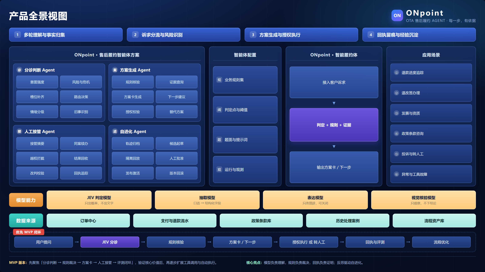
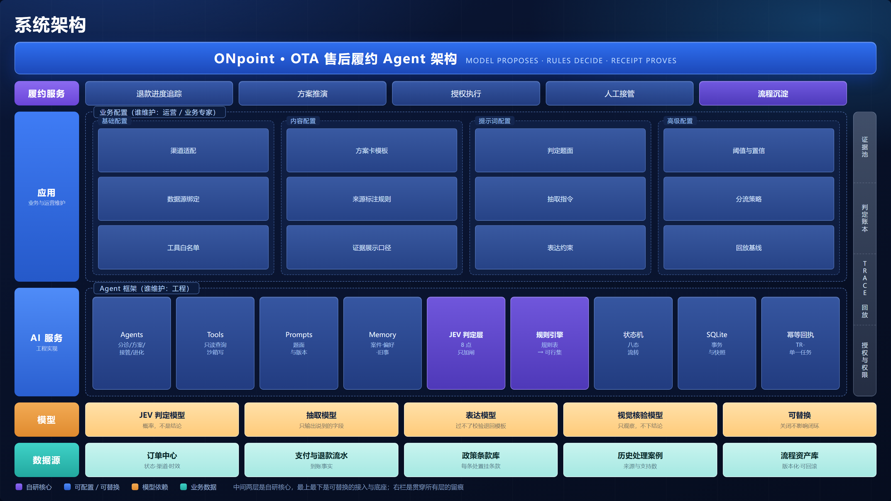

# ONpoint · OTA 售后履约 Agent

> **模型负责听懂，规则负责裁决，回执负责证明。**
> 一个可本地运行的售后履约 Agent：把用户的一句模糊诉求，变成一次有依据、有授权、可回查的处理。

`ONpoint` 是一个 Go + 原生前端的单机演示项目，面向 OTA / 电商售后场景。它不追求"什么都能办"，只回答一个问题：

**一次人工处理，怎样变成下一次真正可调用的能力？**

---

## 两张图看懂

| 产品维度 | 技术维度 |
|---|---|
|  |  |

---

## 为什么做这个

售后的表层现象是"用户在追问退款"，但真正的问题不是客服答得慢，而是用户拿不到确定性：**钱在哪一环、什么时候到、到了谁通知我。** 这三件事对应三种能力：

| 用户要什么 | 系统要有什么 | 本项目的实现 |
|---|---|---|
| 钱在哪一环 | 状态可见 | 证据池（每次查询留痕）+ 到账时钟 + 事件流 |
| 什么时候到 | 承诺可核验 | 政策门 + 用户明确授权 + 执行前重查 + 工具回执（TR-） |
| 下次别再来一遍 | 处理可复用 | 七步候选 → 隔离回放 → 人工批准 → 激活 → 可回滚 |

三条里最容易做假的是第二条，最容易做成"AI 自动改自己"的是第三条。本项目的取舍是：**任何不可逆动作都必须有人的一次明确授权**。

---

## 它长什么样

三个页签，同一个案件 ID 贯穿客户、坐席、工具与经验沉淀：

| 页签 | 做什么 |
|---|---|
| **客户案件** | 用户提问 → 意图分流 → 证据查询 → 方案卡 → 确认 → 工具执行 → 回执 |
| **人工接手** | 带着订单、证据、尝试记录接着办；坐席同样不能绕过政策与用户确认 |
| **流程改进** | 从已完成的真实处理里起草候选 → 隔离回放 → 人工批准 → 激活 / 回滚 |

界面截图见 [`docs/screenshots`](./docs/screenshots)。

---

## 架构

```
用户输入
  │
  ├─ 安全闸（危机/越界词 → 直接转人工，只加闸）
  │
  ├─ JEV 判定层（8 个是非题并发，只输出概率，不输出文字）
  │     └─ 概率 → 阈值比较在 Go 里做 → 不够就不采用
  │
  ├─ 意图分流（静态咨询 / 动态咨询 / 办理请求 / 澄清·风险·人工）
  │
  ├─ 规则核验（业务 · 渠道 · 票状态 · 支付状态 → 可行集）
  │     └─ 无依据 → 停止或转人工，绝不猜
  │
  ├─ 方案卡（事实 + 来源 + 依据 + 步骤 + 风险）→ 用户明确授权
  │
  ├─ 执行前重查（订单状态变了 → 旧方案作废）
  │
  └─ 工具执行 → 幂等回执（TR-）→ 结果确认 → 价值结算
                │
                └─→ 候选流程（七步）→ 回放 → 人批 → 激活 / 回滚
```

### 代码地图

| 文件 | 职责 |
|---|---|
| `types.go` | 案件、证据、任务、政策、流程与版本契约 |
| `engine.go` | 意图分流、工具适配器、政策门、同案人工、确认执行 |
| `jev.go` | JEV 判定层：8 个判定点的题面、版本、阈值、校验 |
| `judge_router.go` | 判定结果的采用策略：off / shadow / assist + 自动回退 |
| `jev_replay.go` | 题面版本回放基线（退化即非零退出） |
| `rules.go` | 业务规则加载与校验（`fixtures/rules.json`） |
| `evolution.go` | 来源校验、候选、真实回放、审批、发布与回滚 |
| `storage.go` | SQLite 原子事务、不可变快照、判定账本 |
| `main.go` | 本机 HTTP 服务与失败回滚 |
| `dist/` | 三个原生前端页签，无构建步骤 |

---

## 快速开始

需要 **Go 1.25+**。只用纯 Go 的 SQLite 驱动，不需要 Node、前端打包器或 C 编译器。

```bash
go run . -addr 127.0.0.1:8088 -data data/ota-routing.db -fixtures fixtures/ota.json
```

打开 <http://127.0.0.1:8088> 。默认只监听本机。

Windows 也可以直接用脚本：

```powershell
.\scripts\Start-ONpoint.ps1
```

### 不配密钥也能跑

JEV 判定层默认 **关闭**（`jev.settings.json` → `shadow` 或 `off`），此时分诊完全走本地规则，全部功能可用。接不接外部判定服务，是增强项，不是闭环成立的前提。

```powershell
.\scripts\Start-ONpoint.ps1 -CheckJEV    # 只检查连通性，不做推理
```

密钥只从环境变量或系统凭据读，不写进仓库。详见 [`docs/大模型Key申请与配置.md`](docs/大模型Key申请与配置.md)。

### 跑测试

```bash
go test ./...
```

---

## 四个值得看的设计

### 1. JEV：判定只加闸，从不放行

8 个判定点，每题独立题面版本、独立阈值、独立回落路径。它们**只输出概率，不输出文字**，阈值比较发生在 Go 代码里。

| 判定点 | 判定什么 | 阈值 | 判不了时 |
|---|---|---|---|
| 进度意图 | 问现有退款进度，还是新的办理请求 | 0.80 | 当作只读 |
| 转人工意愿 | 是不是真要人工（抱怨里带的"人工"不算） | **0.85** | 不转 |
| 方案回应 | 接受 / 拒绝 / 犹豫 | 0.80 | 只亮按钮，不执行 |
| 结果确认 | 问题解决了没有 | 0.80 | 只预选，不结案 |
| 危险信号 | 有无危机表达 | **0.50** | **按有风险处理** |
| 情绪等级 | L1 平静 → L4 极端 | 0.70 | 按 L1，不凭空收紧 |
| 到账状态 | 到了 / 未到 / 部分 | 0.80 | 时钟继续跑 |
| 老问题延续 | 是不是同一用户的旧事 | 0.70 | 正常收集，不跳验证 |

阈值的差异本身是设计：**转人工不可逆，门槛最高；安全漏判代价最高，门槛最低且 fail-closed。**

为什么要它、而不是让大模型直接判，见 [`evaluation/JEV轻量评测与路演论证.md`](evaluation/JEV轻量评测与路演论证.md)——核心一句：**判定点判错最坏是用户多点一下，模型猜错最坏是一个越权动作。**

### 2. 方案卡：事实带来源，依据可展开

每张卡都标出每个事实是**客户陈述**、**工具核验**还是**已发布流程**。没核验的明说没核验。

- Tier 2 的二次确认由**后端强制**：没带确认标记直接 409，什么都不执行
- 出新卡会把上一张已选未执行的卡作废（写明"被新卡取代"），**已执行的卡永不动**
- 用户更正事实后重出卡，并标出变了什么

### 3. 自进化：能自动发布的只有两类资产

> 自进化 ≠ AI 自动修改自己。
> 自进化 = 从真实处理结果中发现问题、定位责任层、形成优化任务，并用历史 Case 验证改动是否真的有效。

- 起草必须有**成功工具回执 + 用户结果确认**；单纯转人工、聊天、工具失败都不算学习证据
- 候选走 `validateProcedure` 五重校验：来源支持数必须一致、不能扩大适用范围、步骤顺序不可改、禁用条件不可删、动作必须在白名单内
- 生命周期：`草稿 → 回放通过 → 人批 → 激活 → 可回滚`，批准必须写人名
- **正确的安全升级不算 bad case**——否则"AI 解决率↑"会把系统推向"少升级"

---

### 4. 承诺时钟：到点了系统先开口，不替支付状态宣布到账

- 追踪任务一建立，就按规则文件给出**可核验的到点时间**（`sla.promise_hours`，默认 72 小时），同时写进任务、案件事实与事件流（`promise_set`）
- 临近与到期各主动触达一次（`promise_soon` / `promise_due`），**同一承诺只提醒一次**，已结案不再打扰
- 开口只能说"仍为处理中、未到账"，并把选择交给用户（继续跟进 / 转人工）；追踪任务回执永远不等于退款回执
- 路演现场想看完整过程：把 `sla.demo_due_in_minutes` 改成 `2`，两分钟后即可看到"倒计时 → 到期 → 系统主动同步"全过程。这是沙箱演示开关，不改承诺口径

> 状态可见不只是把状态画出来。用户真正要的是"什么时候到、到了谁通知我"——画出来只解决第一问，承诺时钟解决第二问。

## 当前提交的能力矩阵

这一节是「这个 commit 真正做到了什么」，不是规划。评审按这一节核对，比按宣传口径核对更省时间。

| 能力 | 状态 | 说明 |
|---|---|---|
| 规则安全预检（关键词） | 生效 | 命中即转人工，只加闸 |
| **持续安全阻断** | 生效 | 命中后写 `SafetyHold`；人工接手不解除，解除需独立动作 + 写明依据 + 留痕 |
| 反馈时钟（跟进时限） | 生效 | 任务建立写入 `DueAt`；**后台每 15 秒扫描**，无需用户发消息也会主动开口 |
| 到期触达 | 生效 | 临近一次、到期一次，事件去重，重启不重复通知；只说"仍处理中、未到账" |
| JEV 八点判定 | 8 题并发 | 判定与账本完整 |
| JEV → 业务分流 | **3 点接入** | 退款进度、人工请求、**安全信号**（判出 risk 即转人工并落阻断） |
| JEV 其余 5 点 | shadow | 只记录观察值，不参与决策；判不出来不会把请求推给人工 |
| `refund_progress` 语义 | 业务归属 | rp.v2：只判「是不是退款进度这件事」，**不判办理意愿**；办理意愿由明确的追踪申请与确认按钮承载 |
| 方案卡 / 确认 / 回执 / 幂等 | 生效 | 一次确认 + token 双校验 |
| 规则 action 驱动分发 | 生效 | 配置声明 `handoff` 就一定转人工；声明 `process` / `static_consultation` 但代码无对应路径时按不可用转人工，不静默降级 |
| 规则版本冻结 | 生效 | 案件与方案卡记住 `RulesHash`；规则一改，旧核验结果与旧批准绑定同时失效 |
| 回放 / 人工批准 / 发布 | 生效 | 限于受审核流程模板的复用 |
| 多方案比较 / Tier 分层 | 未实现 | 当前单方案明确确认 |
| 真实身份隔离 | 未实现 | 本机演示，API 返回全量状态 |

规则可配置的范围（不再宣称「整表替换、零改代码」）：关键词与匹配器、等级、动作、时限与文案、资格四元组、安全词表。
**分发路径仍需在代码里实现**——配置只能收紧，不能凭空生出一条代码里没有的执行路径；声明了不认识的动作会在加载时被拒绝。

已知未做的（下一轮，不影响本机演示）：

- SQLite 每次全量重写状态，试点前改为增量事务。
- `judge_router` 的追问配额：同一缺失信息两次无进展后应转人工。
- 判定账本缺 attempt/commit/accepted 标记，目前只能证明"调用发生过"，不能证明"业务已采用"。

## 数据说明

`fixtures/ota.json` 全部是**人工构造的合成数据**：6 个合成订单、22 条口语提问与反例。不是真实用户明细、不是真实录音、不代表任何平台现行政策。

`fixtures/rules.json` 里的业务规则是**为跑通机制而拟的替身**，不是任何一方的官方售后 SOP。架构只依赖规则表的**形状**，不依赖内容；拿到真实 SOP 后整表替换，代码零改动。

本项目没有真实行业成效指标。回放证明的是**机制与固定用例成立**，不等于真实准确率、解决率或泛化能力。

---

## 边界

- 不是已接大模型的自主规划 Agent。业务对话走本地规则与模板；模型目前只用于判定与抽取，且可关闭
- 工具适配器只读合成数据、只写本地沙箱任务，不产生任何真实资金动作
- 首期只支持 7 个安全步骤的固定顺序，不是通用工作流编辑器
- SQLite 事务供单机演示，不是高并发生产存储设计
- 生产试点还需要：全局安全停用、真实渠道适配、审计导出、多租户隔离

---

## License

MIT，见 [LICENSE](./LICENSE)。
