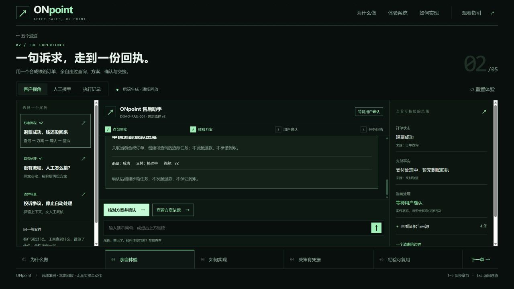
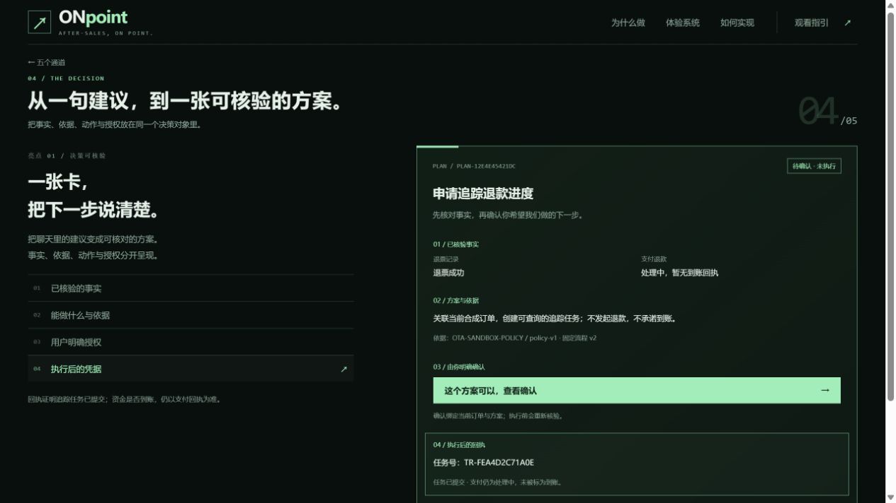

# 路演前端（五通道交互演示）

给评审和观众看的一屏。目标不是把工作台再讲一遍，而是让观众在 90 秒内自己看懂：ONpoint 到底把哪件不确定的事，变成了确定的下一步。

---

## 怎么打开

| 方式 | 入口 | 说明 |
|---|---|---|
| 随服务一起跑（推荐） | <http://127.0.0.1:8088/story/index.html> | `main.go` 用 `FileServer(dist)` 托管，`dist/story/` 自动可访问；原工作台仍在 `/`，互不影响 |
| 纯静态 | 双击 `dist/story/index.html` | 读仓库内已导出的 `replay-data.js`，不需要启动 Go 服务 |

键盘 `1`–`5` 直接切章，`←`/`→` 或底部"下一章"顺序推进。

---

## 页面结构

首页一句话定位："让每一次售后，都有确定下一步。" 下方五条通道由近及远排布，点击后扫描光扫过通道，再揭示对应章节。

| 通道 | 章节 | 讲什么 |
|---|---|---|
| 01 | 为什么做 | 从用户的不确定出发：订单与支付分开查、每个结论带来源 |
| 02 | 亲自体验 | 一句口语诉求 → 分诊 → 方案卡 → 授权 → 回执，完整走一遍 |
| 03 | 如何实现 | 沿一条消息的旅程，看清规则层 / 判定层 / 工具层 / 存储层 |
| 04 | 决策有凭据 | 方案、授权、执行三件事分开；风险进人工不硬答 |
| 05 | 经验可复用 | 人工处理进入回放与审核，再成为下次的流程资产 |

章节内顶部是吸顶章节索引（01–05 + 下一章），不再放在底部——底部索引在投屏时容易被裁掉。

---

## 一条硬边界：对话与后端逻辑分开

体验章是本页最容易被误读的地方，因此定了两条规则：

1. **左侧对话区只呈现"用户 ↔ 客服"的真实交互。** 客户气泡与人工坐席气泡，文本经过清洗，去掉时间戳、技术来源字段，改口语化。
2. **后端生成的动作不当作对话。** 例如"客户点击『核对方案并确认』"这类由流程产生的授权动作，用虚线框的**授权标记**单独呈现，并注明"由后端流程生成，非客户输入"。
3. **后端逻辑独立成栏。** 右侧"后端处理逻辑"栏展示：分诊意图、路由决策、引擎裁决、工具链路、风险标记、案件归属——全部来自 Store 真实字段，不手写。

这样观众看到的是"客服在跟客户说什么"，和"系统在同一时刻判断了什么"，两者对齐但不混淆。

第二章还带一条**能力覆盖条**（14 个能力芯片），点击任一能力直接跳到对应案例，方便现场按问题回答："这个能力你们有吗？"





---

## 文件清单

```
dist/story/
  index.html                 页面骨架（五通道 + 五章容器）
  story.css                  主体样式（通道、章节、对话、方案卡）
  upgrade.css                本轮增补：吸顶索引、授权标记、后端逻辑栏、能力覆盖条
  story.js                   状态机、章节渲染、对话与后端逻辑分栏渲染
  diagrams.js                两幅架构图的矢量绘制
  architecture-product.svg   产品架构图（静态版）
  architecture-system.svg    系统架构图（静态版）
  replay-data.js             33 帧真实引擎状态快照（由 Go 测试导出）
export_story_test.go         导出回放数据的 Go 测试
tools/story/
  build-single.cjs           打包成单个离线 HTML
  verify.cjs                 16 项自检
  build-diagrams.cjs         重新生成架构图
  serve.cjs                  本地静态预览
  Start-实时体验.ps1         Windows 一键启动
```

---

## 数据从哪来

页面里没有一个字是手写的演示文案。`replay-data.js` 由 Go 测试跑真实引擎导出：

```bash
go test -run TestExportStoryReplay -v .
# exported 33 frames to dist\story\replay-data.js
```

这些帧覆盖：查询/政策咨询、追踪与受控办理、异常争议转人工、风险拦截、以及自进化（草稿 → 回放 → 审批 → 激活）的完整链路。

导出的都是**合成订单与口语提问**（`fixtures/ota.json`），不涉及真实用户数据。改了引擎行为后重跑一次，路演页会跟着变——演示内容不会和实现脱钩。

---

## 现场怎么用

```bash
# 1) 启动服务
go run . -addr 127.0.0.1:8088 -data data/ota-routing.db -fixtures fixtures/ota.json
# 浏览器打开 /story/index.html

# 2) 或者打包成单文件带去现场
node tools/story/build-single.cjs    # → ONpoint-交互路演.html
node tools/story/verify.cjs          # 16 项自检

# 3) Windows 一键
.\tools\story\Start-实时体验.ps1
```

单文件 HTML 内联了全部 CSS/JS/数据，可离线双击打开，也方便邮件发送或拷 U 盘。
