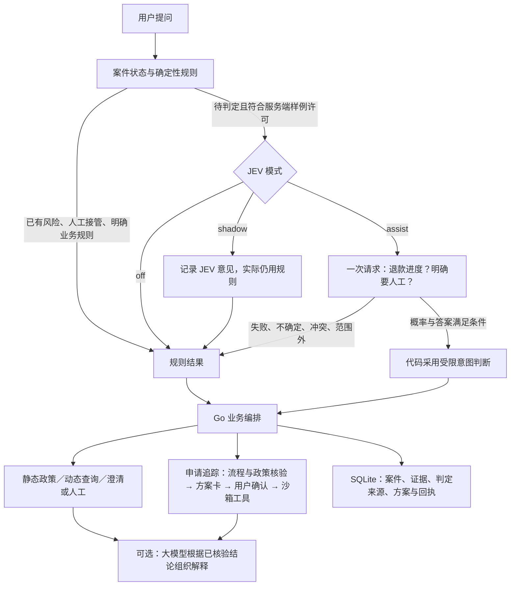

# JEV：怎样证明它对当前 MVP 有用

核对日期：2026-10-24。依据当前 `ONpoint` 源码，以及一套更早的、同思路的服务端实现作为对照；不把对照项目的成绩当成本项目结果。

建议向评委证明一个具体命题：**在业务规则和授权流程固定的前提下，JEV 能否让系统多听懂一些规则漏掉的表达，同时不增加误分流和越权动作。**

当前已证明的是连接和鉴权；尚未取得当前 MVP 的在线 JEV 质量成绩。接通、能返回答案、答案被系统采用、最后业务处理正确，是四件不同的事。

## 1. 现状：它插在什么位置

图中的大模型是代码已有的可选解释环节，需 `LLM_MODE=grounded` 等配置才启用；并非每条消息都会调用。它在确定性业务动作提交后，根据服务端结论组织解释，不负责 JEV 的分类，也不批准工具动作。

实际 JEV 请求的 state 只有当前合成提问，两个 Choice 问题合并一次发送。JEV 并没有承担完整四路分类：是否静态咨询、是否具备订单证据、是否允许办理、是否需要确认，仍由代码处理。

当前 assist 的条件：人工 yes ≥0.90 则可交人工；人工 no ≥0.90 且退款进度 yes ≥0.85 则可补充识别退款进度；相关选项需领先其他选项至少0.20。阈值是初始工程参数，并非经评测校准的正确率。

当前文本许可检查是与 `fixtures/ota.json` 的样例原文精确匹配。新写一段话到页面里，可能根本不会调用 JEV。评测必须区分“模型没听懂”和“这一条未被允许送入模型”。

## 2. 从工程上，为什么值得接入

规则适合已有明确表达，模型有机会补充口语、否定和同义改写。例如“车次取消手续已经办结，原路返还那笔走到哪儿了”，应先理解为既有退款进度查询，再由工具核验事实。模型不是事实来源。

但 JEV 不是业务闭环成立的必要条件：规则模式已经能够运行。它的必要性需要表现为**在可接受的额外耗时与费用下，修正更多规则错误，而新增错误更少**。若没有这个增益，保持规则模式就是合理结论。

这版不能先宣称“少调用大模型、成本下降”。当前大模型是后置解释层，JEV 不直接控制其全部调用；增加 JEV 本身也有开销。需实测调用次数、token 与总耗时后，才讨论净成本。也不应把分流改善等同于退款到账、工单解决率或人工工时下降。

## 3. 一份小评测集就够开始

已准备 `jev-cases-50.draft.jsonl`：**50 条人工构造的合成题草案**，没有真实客户记录。

| 部分 | 数量 | 用途 |
|---|---:|---|
| 当前已使用的开发样例 | 22 | 理解覆盖范围、核对问题与标签；不当作独立泛化成绩 |
| 新增退款进度改写 | 8 | 看规则漏掉的表达能否被补上，含2条较直白的对照题 |
| 新增人工意愿与否定表达 | 6 | 看是否听懂“要真人”和“不用转人工” |
| 新增范围外、信息不足与相近表达 | 6 | 防止只看到“退款”或“人工”就误分流 |
| 新增风险、授权及业务边界 | 8 | 检查投诉、赔偿、越权、只查不办、缺订单、酒店、已到账、状态未知 |

共22条开发题、28条待复核验收题。每条带来源、订单条件、两个独立判定标签草案；新增题另带建议路由、案件状态、禁止发生的动作。先由业务人员复核，争议题可以改为“不确定”，复核后冻结题目、标签、模型版本和阈值。

**这批新题是在看过代码后编写的工程挑战集，不是独立盲测集。** 如果后面要声称泛化能力，可让未参与写规则的人再提供一小批未见表达。不要一边看验收答案一边改关键词，再称同一批题为独立验收。

本次仅制作草案，没有将它加入运行白名单、改动业务数据库或调用在线推理。JSONL 是评测设计材料，尚不能直接交给当前“批量对照”按钮读取。

## 4. 对照怎么做：只需要两组

- **A组：off，只有规则。**
- **B组：assist，规则＋受限 JEV。**

同一条题在独立的新案件中跑两次。订单数据、政策、流程快照、初始状态及业务动作保持一致；评测时关闭大模型解释，避免解释质量和延迟混入分流效果。每题绑定固定订单条件，不复用前一题的人工接管或风险状态。

shadow 可先收集问题，但它不会改变实际路由，所以仅比较 off 与 shadow 不能证明业务分流改善。B组仍应经过当前实际规则门、概率门和失败回退；硬规则直接处理的样例不强制调用 JEV，也不把这些成功算成 JEV 的独立贡献。

先用22条开发题核对协议与标签，冻结后只用28条新题报告主要对照结果。没有必要现在比较四五种模型、训练本地分类器或建设大型评测平台。

## 5. 向评委展示的指标

| 指标 | 计算与解释 |
|---|---|
| 最终分流正确数 | A、B分别答对多少条／验收总条数。看业务路径，不只看模型输出 |
| 净修正 | 列出“A错B对”与“A对B错”的条数；二者之差就是本批样例的净增益 |
| 采用覆盖率与采用精确率 | 覆盖率＝实际采用模型的条数／满足调用条件的条数；精确率＝采用且正确／采用总数。同时报告实际调用数、失败数和回退数 |
| 人工意愿是否被尊重 | 明确要人工的漏转数，以及明确不要人工的误转数，保留各自分母 |
| 边界是否守住 | 越权创建任务、跳过确认、被模型解除风险等次数；这批边界题中应为0，出现即先修复 |
| 额外代价 | JEV请求数、输入token、实际总耗时中位数与P95或最大值；费用按当期价格估算并标为估算 |

超时或断网后若正确回退，业务最终结果仍可以答对，但模型成功率必须记失败。没有执行完的题记“未完成”，不得删掉后用成功样本算总体成绩；延迟也要保留超时等待。采用数为0时，采用精确率是“不可计算”，不是100%。

confidence 或选项概率不是实测准确率。最终正确与否要与复核后的标签比较。当前页面的“两个判定点符合数”只能提供诊断线索；不能直接替代最终路由评测。

50条中只有28条新验收题，各类分母更小。展示“几条／几条”即可；不要把一次小样本的百分比包装成生产正确率。

## 6. 当前代码还差的最小补充

1. 一个隔离评测入口：读冻结后的题集，逐条使用现有 `classify`、`decideIntake` 和业务引擎跑A/B，导出逐条结果，不写演示业务库。
2. 显式、独立的人工标签。当前 `labelJudgment` 用业务 Intent 推导退款标签，并按三个固定样例ID判断是否要人工；把新题直接塞进 fixtures 会造成错误标签。需要改为读取复核后的两个标签，不能拿规则结果自己当标准答案。
3. 一张汇总表和一页失败案例。保留输入、调用是否发生、模型原始答案、实际采用结果、最终路由、失败原因、模型与问题版本、耗时和用量。

以上是后续最小实现建议，本次没有改动评测执行代码。运行前还需为冻结题集建立明确的隔离外发许可；业务页面的自由输入白名单不必扩大。当前 JSONL 的 `review_status` 全部为待复核。

## 7. 从对照项目借用什么

旧版 `backend/cmd/jeveval/main.go` 已按判定点记录答案、采用率、采用中的正确率、延迟，并输出逐条结果。`backend/internal/judge/triage.go` 提出从影子到生效需看判定点成绩、分歧和回落路径；`backend/eval/frozen_config.yaml` 固定口径。借用这三点即可。

旧前端 Bakeoff 中的百分比和耗时是历史结果写入页面，不是当前MVP现算的；旧版还比较了大模型、分类器和关键词，这版不必照搬。旧版“每个判定点至少50条”等晋升标准也不能用这里“总共50条、含开发题”的样本量冒充满足。

现有的超时、非法响应、风险优先、并发结果过期及模型失效回退测试，能证明某些工程保护已实现；它们使用模拟模型，不能证明线上 JEV 听懂自然语言的质量。协议验证与模型效果验证都应保留，但结论分开。

## 8. 给评委怎么讲

目前可直接说：

> 我们把 JEV 放在输入理解环节，只让它回答退款进度和人工意愿两个小问题。业务规则核验事实与权限，模型不确定就回退。我们准备了50条合成提问，其中22条用于开发、28条用于验收草案；接下来在相同业务条件下比较规则模式和JEV辅助模式，观察净修正、误分流、边界错误以及新增耗时和用量。连接已经验证，当前还不宣称质量收益。

取得评测结果后，用实测数替换：

> 在冻结的N条验收题中，规则正确a条，加入JEV后正确b条；它修正x条，也新增y条错误。实际采用z条，其中正确k条；边界题违规v条，额外耗时和用量为实测值。因此我们只在已验证的范围启用，保留回退能力。

这已经构成清楚的论证过程：业务问题 → 可验证假设 → 同条件对照 → 可检查的收益与代价 → 有边界地启用。

## 核对来源

- 当前源码：`judge_router.go`、`judge_integration.go`、`jev.go`、`engine.go`、`main.go`、`llm.go`、`dist/presentation.js`、`fixtures/ota.json`。
- 对照实现：另一套 Go 服务端的判定层（`backend/internal/judge/triage.go`、`backend/eval/frozen_config.yaml`）与其前端评测页（`frontend/src/features/jev/components/Bakeoff.tsx`）。
- [TypeSafe 路由模式](https://docs.typesafe.ai/patterns/intent-routing)：可把不同请求送入规则、大模型或人工；本方案实际覆盖范围以MVP代码为准。
- [TypeSafe confidence 说明](https://docs.typesafe.ai/confidence)：confidence 是概率分布的集中程度，业务阈值需在自己的数据上检验。
